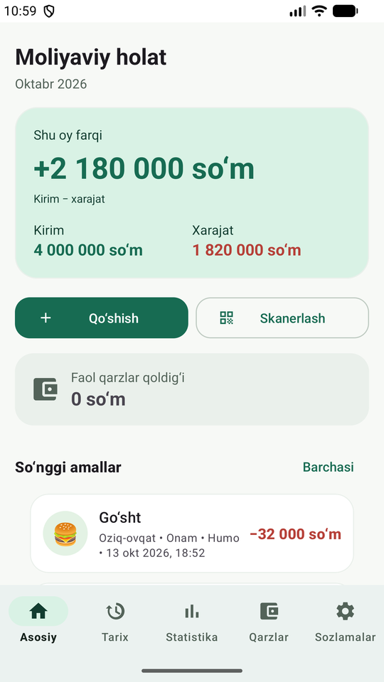
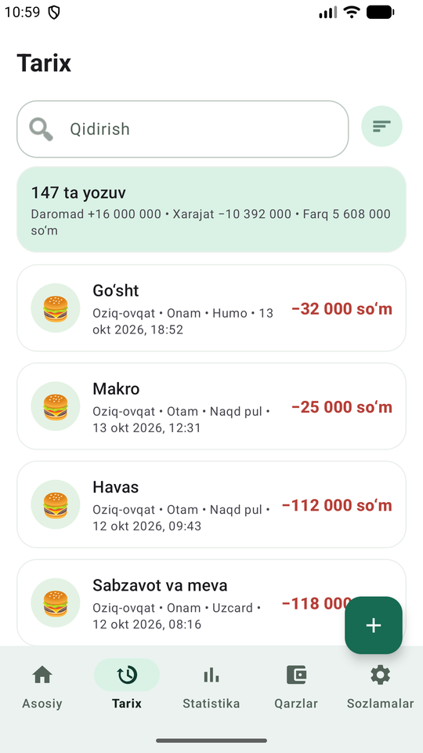
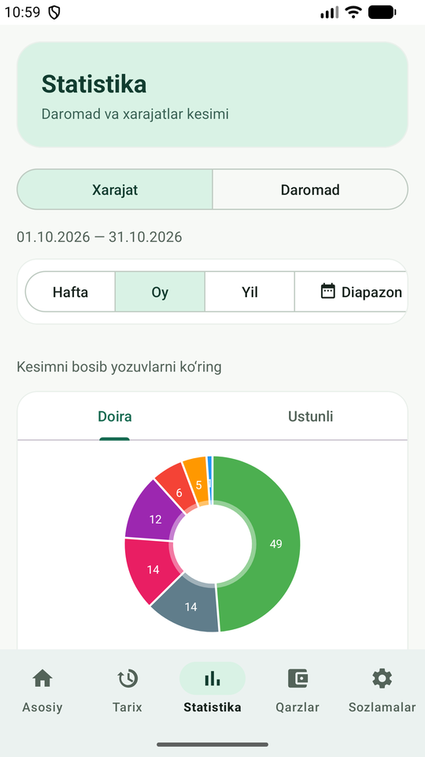

# Xarajatlar

[O'zbekcha](#-ozbekcha) · [English](#-english)

[](https://buymeacoffee.com/jtscorp)

<p>
  
  
  
</p>

***

## 🇺🇿 O'zbekcha

Xarajatlar — oila xarajat va daromadlarini hisobga olish uchun Android ilova. Har bir xarajat kim tomonidan, qaysi kategoriyada va qaysi karta yoki naqd pul bilan qilinganini ko'rsatadi.

Barcha ma'lumotlar faqat telefonning o'zida saqlanadi. Server ham, akkaunt ham yo'q, ilova internetga faqat chekni ochish uchun ulanadi.

### Imkoniyatlar

- **QR chek:** do'kon chekidagi QR kod skanerlanadi va ofd.soliq.uz'dan summa, do'kon nomi va mahsulotlar ro'yxati avtomatik olinadi.
- **OCR:** QR kodi bo'lmagan chekdagi summani kamera orqali matndan o'qish.
- **Xarajat va daromad:** kategoriya, oila a'zosi, to'lov usuli (naqd pul yoki karta), izoh va do'kon nomi bilan.
- **Tarix:** barcha yozuvlar bitta ro'yxatda. Qidirish, tur, sana, kategoriya, oila a'zosi, to'lov usuli va summa oralig'i bo'yicha filter, sana yoki summa bo'yicha sort qilish mumkin.
- **Statistika:** hafta, oy, yil yoki tanlangan diapazon bo'yicha. Doira va ustunli grafiklar orasida surib o'tish mumkin, grafik kesimini bosib shu yozuvlarni ochish mumkin.
- **Qarzlar:** kimga qancha berilgani, qaytarish muddati va qaytarilgan qismi. Har bir qarzga GPS joylashuv hamda rasm, video yoki audio dalil biriktiriladi.
- **Xavfsizlik:** ilova PIN kod yoki barmoq izi bilan ochiladi.
- **Backup:** ma'lumotlar `.zip` faylga eksport va undan import qilinadi. Avtomatik kunlik backup yoqilsa, fayllar `/storage/emulated/0/backups` papkasiga yoziladi. Bu papka ilova o'chirilganda ham saqlanib qoladi.
- **Sozlamalar:** oila a'zolari, xarajat va daromad kategoriyalari (emoji va rang bilan), to'lov usullari, valyuta nomi.
- **App shortcuts:** ilova ikonkasini bosib turganda QR skanerlash, OCR va xarajat qo'shish tez ochiladi.
- **3 til:** o'zbekcha, ruscha va inglizcha. Tilni ilova ichida almashtirish mumkin.

### O'rnatish

1. [Releases](https://github.com/jtscorp/Xarajatlar/releases) sahifasidan `Xarajatlar-vX.Y.Z.apk` faylini yuklab oling.
2. Telefonda faylni oching. Android birinchi marta "noma'lum manbalardan o'rnatish"ga ruxsat so'raydi, ruxsat bering.

Ilova Android 15 (API 35) va undan yuqori versiyalarda ishlaydi. Samsung S23 Ultra'da test qilingan.

Avtomatik backup uchun Sozlamalarda "Barcha fayllarga ruxsat" berilishi kerak.

### Source'dan build qilish

JDK 25 va Android SDK (API 35) kerak.

```
./gradlew assembleDebug         # debug APK -> app/build/outputs/apk/debug/
./gradlew testDebugUnitTest     # unit testlar
./gradlew assembleRelease       # release APK -> app/build/outputs/apk/release/
```

Release APK'ni imzolash uchun `~/.xarajatlar-signing/keystore.properties` fayli kerak:

```
storeFile=/path/to/xarajatlar-release.jks
storePassword=...
keyAlias=...
keyPassword=...
```

Bu fayl bo'lmasa, release APK imzosiz build qilinadi.

### Release

`v*` ko'rinishidagi tag push qilinganda GitHub Actions imzolangan APK'ni build qiladi va uni shu tag'ning Release'iga biriktiradi:

```
git tag v2.0.1
git push origin v2.0.1
```

Tag `app/build.gradle.kts` ichidagi `versionName` bilan bir xil bo'lishi kerak. Repo sozlamalarida (`Settings → Secrets and variables → Actions`) quyidagi secret'lar bo'lishi kerak:

| Secret | Qiymat |
|---|---|
| `KEYSTORE_BASE64` | `base64 -w0 xarajatlar-release.jks` natijasi |
| `KEYSTORE_PASSWORD` | keystore paroli |
| `KEY_ALIAS` | kalit alias'i |
| `KEY_PASSWORD` | kalit paroli |

***

## 🇺🇸 English

Xarajatlar ("Expenses") is an Android app for tracking family expenses and income. Every expense shows who made it, in which category and with which card or cash.

All data is stored only on the phone. There is no server and no account; the app goes online only to open a receipt.

### Features

- **QR receipts:** scan the QR code on a store receipt and the amount, store name and list of items are loaded from ofd.soliq.uz automatically.
- **OCR:** read the amount from a receipt without a QR code using the camera.
- **Expenses and income:** with category, family member, payment method (cash or card), note and store name.
- **History:** all records in one list. Search, filter by type, date, category, family member, payment method and amount range, and sort by date or amount.
- **Statistics:** by week, month, year or a custom range. Swipe between pie and bar charts, tap a slice to open its records.
- **Debts:** who owes how much, the due date and the part already paid back. Each debt can have a GPS location and photo, video or audio evidence.
- **Security:** the app is unlocked with a PIN or fingerprint.
- **Backup:** export data to a `.zip` file and import it back. With daily auto backup on, files are written to `/storage/emulated/0/backups`, which survives uninstalling the app.
- **Settings:** family members, expense and income categories (with emoji and color), payment methods, currency label.
- **App shortcuts:** long-press the app icon to open QR scan, OCR or add an expense directly.
- **3 languages:** Uzbek, Russian and English. The language can be switched inside the app.

### Install

1. Download `Xarajatlar-vX.Y.Z.apk` from the [Releases](https://github.com/jtscorp/Xarajatlar/releases) page.
2. Open the file on the phone. On the first install Android asks to allow installing from unknown sources; allow it.

The app runs on Android 15 (API 35) and newer. It has been tested on a Samsung S23 Ultra.

Auto backup needs "All files access" granted in Settings.

### Build from source

JDK 25 and the Android SDK (API 35) are required.

```
./gradlew assembleDebug         # debug APK -> app/build/outputs/apk/debug/
./gradlew testDebugUnitTest     # unit tests
./gradlew assembleRelease       # release APK -> app/build/outputs/apk/release/
```

Signing the release APK needs a `~/.xarajatlar-signing/keystore.properties` file:

```
storeFile=/path/to/xarajatlar-release.jks
storePassword=...
keyAlias=...
keyPassword=...
```

Without this file the release APK is built unsigned.

### Release

Pushing a tag like `v*` makes GitHub Actions build a signed APK and attach it to that tag's Release:

```
git tag v2.0.1
git push origin v2.0.1
```

The tag must match `versionName` in `app/build.gradle.kts`. The repository settings (`Settings → Secrets and variables → Actions`) need these secrets:

| Secret | Value |
|---|---|
| `KEYSTORE_BASE64` | output of `base64 -w0 xarajatlar-release.jks` |
| `KEYSTORE_PASSWORD` | keystore password |
| `KEY_ALIAS` | key alias |
| `KEY_PASSWORD` | key password |
